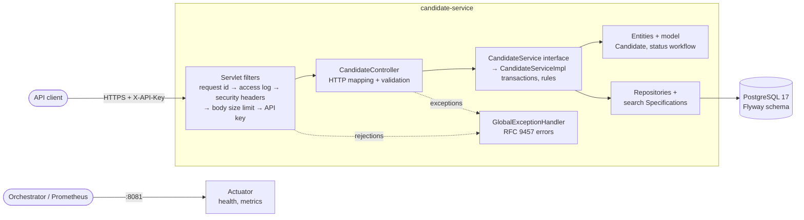
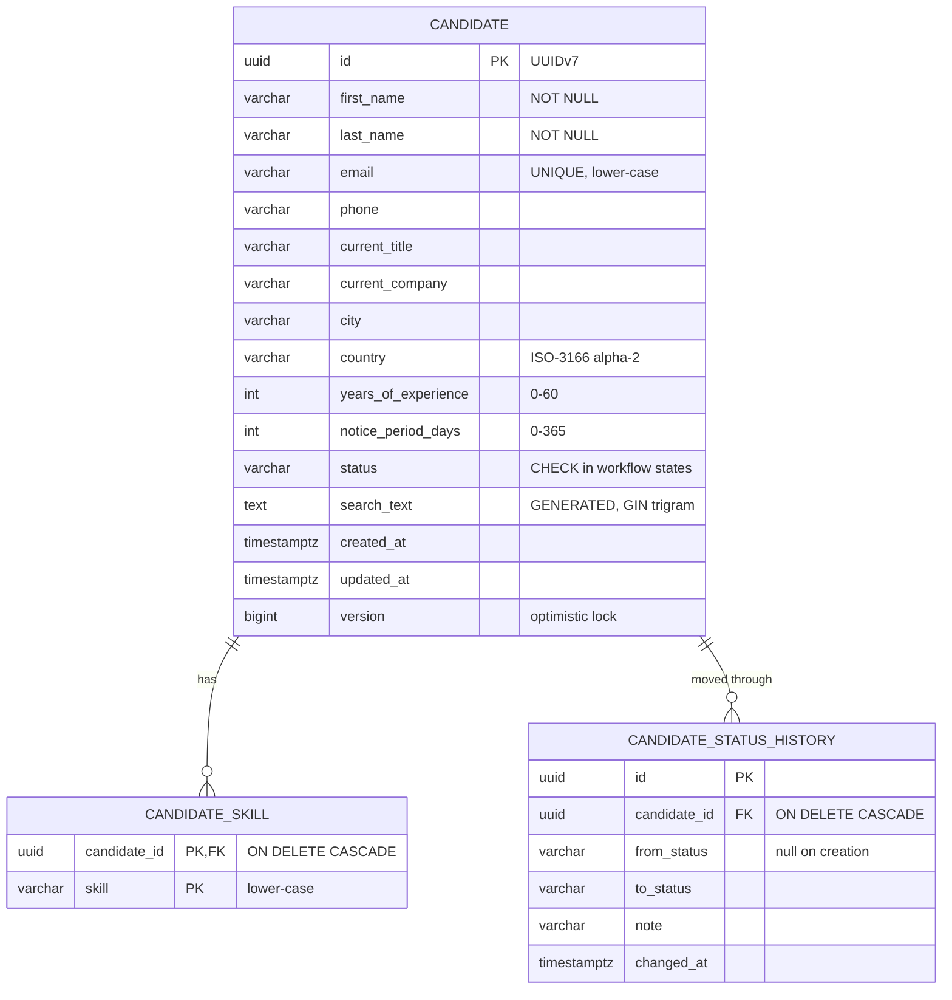

# Candidate Service: Design

## 1. Goal and scope

A backend service that lets other systems **create, view, update, delete, search and filter candidate information**,
with persistence, robust input and error handling, and automated tests. It is a server-side product with no frontend
and no user accounts; consumers are other services, scripts and API tools.

Guiding principle: meet every requirement to a production standard, add only features that demonstrate a distinct
engineering concern, and keep the code explainable. Large-scale concerns are designed for and written down
(section 11), not built speculatively.

**Deliberate non-goals:** UI, user accounts and login, resume upload/parsing, multi-tenancy, soft delete and audit
trail, caching, external search engine. Each has a trigger and an approach in [Future scope](#12-future-scope).

## 2. Architecture and object-oriented design



**Layered packages:** `controller`, `service` (interfaces) with `service/impl` (implementations), `repository`,
`entity`, `model`, `dto`, `mapper`, plus cross-cutting `exception`, `filter`, `config`, `validation` and `util`. The
controller depends only on the `CandidateService` interface; `CandidateServiceImpl` holds the transactional logic.
ArchUnit enforces the rules in the build:
- calls go controller → service → repository, and only the service uses mappers and repositories
- the controller never sees `service/impl` or entities
- `service` holds only interfaces; every implementation is an `@Service` named `*Impl` that implements one
- entities and model have no web or DTO dependencies; cross-cutting packages never reach into business layers
- transactions exist only in service implementations; no package cycles; no field injection

**Request lifecycle:** filters reject cheaply first (size before authentication), the controller binds and validates,
the service applies business rules inside a transaction and maps the result to a DTO before the transaction ends (so
nothing lazy leaks), and any exception, from any layer including filters, is rendered by one handler.

### Object-oriented fundamentals

| Concept | Where it shows |
|---|---|
| Encapsulation | `Candidate` has private fields and no setters. Its state changes only through `register`, `updateProfile` and `changeStatus`, which keep its invariants: status is never part of a profile edit and `updatedAt` always moves. `getSkills()` returns a read-only view |
| Abstraction | Callers see what, not how: the controller sees the `CandidateService` contract, not JPA; failing code names an `ErrorCode` instead of choosing an HTTP status; `Specification` hides how the SQL is built |
| Inheritance | Kept one level deep: seven typed exceptions extend `ApplicationException`. Otherwise only framework extension points are inherited (`OncePerRequestFilter`, `ResponseEntityExceptionHandler`, `JpaRepository`) |
| Polymorphism | One handler method renders every `ApplicationException` subclass through `errorCode()`, `details()` and `violations()`; `CandidateMapper.toProfile(ProfileFields)` accepts both create and update requests; `toResponse` is overloaded for candidates and history entries |

### Design principles

| Principle | Where it shows |
|---|---|
| Separation of concerns | Each layer does one kind of work (HTTP, business rules, persistence). Cross-cutting concerns (correlation ids, access logging, security headers, size limits, authentication) live in filters; error rendering lives in one handler |
| Program to an interface | `CandidateService`, the Spring Data repository interfaces, `Specification`, and an injected `java.time.Clock` instead of calling `Instant.now()` |
| Composition over inheritance | The service is assembled from repositories and a `Clock`; a search is assembled from small `Specification` predicates; the filter chain is assembled in `WebFilterConfig`. Inheritance is reserved for the exception taxonomy and framework hooks |
| Tell, don't ask (information expert) | The service tells `candidate.changeStatus(target, now)` instead of checking the status itself; `CandidateStatus` owns the transition table, so each rule lives with the data it governs |
| Law of Demeter | Each class talks only to its direct collaborators: controller → service → repositories and entity methods. Nothing outside `Candidate` changes its fields or its skill set |
| High cohesion, low coupling | Each package holds one kind of responsibility; dependencies point one way (controller → service → repository) and ArchUnit checks them |
| Acyclic dependencies | No package cycles (ArchUnit). The request-id constants live in `util/RequestContext`, so the filter and exception packages do not depend on each other |
| Immutability | DTOs and value objects are records; status-history rows are `@Immutable`; the controller and service hold only `final` fields, so these singleton beans are stateless and thread-safe |
| Fail fast | Bad configuration stops startup (validated API keys, Hibernate schema validation); bad input is rejected at the boundary before business code runs; `CandidateProfile` refuses missing required fields |
| Design by contract | The service interface documents each method's errors (`@throws`). Preconditions are enforced by validation, invariants by the entity (status workflow) and by the database (unique email, `CHECK` constraints, cascading foreign keys) |
| DRY / single source of truth | `ErrorCode` holds the status, title and type of every error; the transition table exists once; `Normalizer` holds every normalization rule; `ProfileFields` shares one set of validation patterns between create and update |
| KISS and YAGNI | Hand-written static mapper, one service interface, no cache, event bus or search engine. Each deferred item has a trigger in [Future scope](#12-future-scope) |

### SOLID principles

| Principle | Where it shows |
|---|---|
| Single responsibility | The controller only maps HTTP; the service owns rules and transactions; the mapper only maps; each filter does one job; `GlobalExceptionHandler` is the only place that builds error responses |
| Open/closed | A new search filter is one more `Specification` composed in `CandidateSpecifications.matching`; a new error is a new `ApplicationException` subclass plus an `ErrorCode`, with no change to the handler |
| Liskov substitution | The handler treats every `ApplicationException` subclass through the base type; `CreateCandidateRequest` and `UpdateCandidateRequest` are interchangeable as `ProfileFields` for the mapper |
| Interface segregation | `ProfileFields` exposes only the fields create and update share. `CandidateService` is one interface because it has one client (the controller); it would split into query and command interfaces if a client needed only part of it |
| Dependency inversion | The controller depends on the `CandidateService` interface; the service depends on Spring Data repository interfaces and an injected `Clock`; everything is constructor-injected |

### Design patterns

**Gang of Four patterns**

| Pattern | Kind | Where |
|---|---|---|
| Strategy | Behavioural | `Clock` is an interchangeable time source: `Clock.systemUTC()` in production (`TimeConfig`), `Clock.fixed(...)` in tests, and the service cannot tell which. Each `Specification` is an interchangeable query rule passed to `repository.findAll(spec, pageable)` |
| Singleton | Creational, managed by Spring | The controller, service, exception handler and `Clock` are singleton-scoped beans; each filter is created once at startup and shared by all requests. Safe because none holds mutable state. No hand-written `getInstance()`; enum constants (`CandidateStatus`, `ErrorCode`) are singletons by language design |
| Template method | Behavioural | Filters fill in `doFilterInternal` of `OncePerRequestFilter`; `GlobalExceptionHandler` overrides hooks of `ResponseEntityExceptionHandler` |
| Chain of responsibility | Behavioural | The servlet filter chain: request id → access log → security headers → size limit → API key; any link can stop the request |
| Composite | Structural | `Specification.allOf(...)` combines many predicates into one that is used like a single predicate; "has all skills" is itself a composite of "has skill X" |
| Facade | Structural | `CandidateService` gives the controller one call per use case, hiding repositories, entity rules, status history and mapping |
| Proxy | Structural, provided by Spring | `@Transactional` on `CandidateServiceImpl` works through a proxy that opens and commits the transaction around each call; Spring Data generates the repository implementations as proxies |

**Other patterns**

| Pattern | Source | Where |
|---|---|---|
| Layered architecture | Architectural | The packages above, enforced by ArchUnit |
| Repository | Fowler / DDD | `CandidateRepository`, `CandidateStatusChangeRepository` (Spring Data) |
| Specification | Evans and Fowler | `CandidateSpecifications`: one small predicate per criterion, combined with AND |
| Null object | Woolf | With no criteria, `Specification.unrestricted()` stands in for "no filter", so the search needs no special case |
| Data transfer object and mapper | Fowler | Request/response records; `CandidateMapper` keeps entities out of the API |
| Value object | DDD | `CandidateProfile`, `CandidateSearchCriteria`: immutable records, normalized on construction |
| Table-driven state machine | General | `CandidateStatus` holds the allowed transitions; `Candidate.changeStatus` enforces them |
| Static factory method | Effective Java (not the subclass-based GoF Factory Method) | `Candidate.register`, `CandidateStatusChange.of`, `PageResponse.of` |
| Optimistic offline lock | Fowler | `version` on every write, checked explicitly and backed by `@Version` |

**Not used, and why**

| Pattern | Why not (yet) |
|---|---|
| Observer | The only reaction to a status change is the history row, which must be written in the same transaction; an event would add indirection for one listener. It becomes right when other parts must react (notifications, analytics): publish `CandidateCreated` / `StatusChanged` domain events through a transactional outbox ([Future scope](#12-future-scope)) |
| Strategy for skill matching | `SkillMatch` ALL/ANY is chosen with a conditional. With more match modes, each `SkillMatch` constant would build its own specification |
| GoF State | Statuses differ only in which moves they allow, not in behaviour, so a transition table is simpler than one class per state |
| Decorator | No behaviour is layered onto objects at runtime; cross-cutting concerns are handled by filters and Spring proxies |
| Builder | Only in tests (a criteria builder for readable fixtures). In production each object is created in one place from complete data |

### Where a principle is deliberately bent

- **JPA needs a no-argument constructor and mutable fields.** `Candidate` keeps the constructor `protected` and has no
  setters, so the compromise stays invisible to the rest of the code.
- **Commands return data.** `create`, `update` and `changeStatus` return the updated candidate, which bends
  command-query separation. It saves clients a second request and gives them the new `version` they need for their
  next write.
- **Static mapper.** It cannot be swapped through dependency injection. That is acceptable while it is a pure function
  with no collaborators (see [Key decisions](#3-key-decisions)).
- **One service interface for all use cases.** Interface segregation would split it as soon as a second client needs
  only part of it.

## 3. Key decisions

| Decision | Why | Rejected alternative |
|---|---|---|
| **Spring Boot 4.1 on Java 21** | Current supported line; validation, data, observability built in; widely understood | Spring Boot 3.5 (older line), Quarkus/Micronaut (no benefit here) |
| **PostgreSQL everywhere, including tests (Testcontainers)** | Constraints, transactions, trigram indexes and generated columns; tests run against the same engine and migrations as production | H2 for tests: different SQL dialect, no `pg_trgm`, false-green tests |
| **Flyway owns the schema; Hibernate only validates** | Reviewable, versioned DDL; a mapping mismatch fails at startup | `ddl-auto=update` |
| **Resource-style REST, versioned path `/api/v1`** | Idiomatic; GET is safe and PUT/DELETE are idempotent; works with standard tooling | POST-only RPC (kept as future scope, see 12) |
| **Status changes via `PATCH /{id}/status`, not `PUT`** | Pipeline moves have rules and side effects (history), profile edits do not. Strict JSON rejects `status` in `PUT`, so rules cannot be bypassed | Status as an ordinary field |
| **Optimistic locking: client sends `version`** | Two recruiters editing the same candidate must not silently overwrite each other; no locks held between requests | Last write wins; pessimistic locks |
| **Hard delete** | Erases personal data (GDPR right to erasure); no `deleted` filter in every query, no partial unique index | Soft delete (future scope, with an audit log) |
| **UUIDv7 primary keys** (Hibernate `VERSION_7`) | Not enumerable like sequences; time-ordered so B-tree inserts stay local; safe to merge across systems | bigint identity (enumerable), UUIDv4 (random index writes) |
| **Single search endpoint with composable JPA Specifications** | One parameterized query for any combination of criteria; each criterion is a small, testable function | Hand-built SQL strings (injection risk), Querydsl (extra tooling) |
| **Free text via trigram index on a generated `search_text` column** | Recruiters type fragments of names and emails; `LIKE '%term%'` becomes index-assisted | Unindexed `LIKE` (full scans); full-text search (stemmed words, poor for partial names and emails); Elasticsearch (operational cost unjustified at this size) |
| **Pagination always on, size 1-100, out-of-range rejected (not clamped)** | Bounded cost for every request; machine clients learn their request was wrong instead of silently receiving less | Optional pagination; silent clamping |
| **`id` appended to every sort** | Equal sort values (same experience) would otherwise reorder between page requests, duplicating or skipping rows | Sort by the requested field only |
| **Static API key (several allowed), compared as SHA-256 digests in constant time** | Personal data must not be open; there is no user model, so a key is the simplest correct control; several keys allow rotation without downtime | HTTP Basic with users and roles (implies a login model), issuing our own JWTs (re-building an identity provider) |
| **Typed exceptions + one `@RestControllerAdvice`** | Code throws, one place translates; consistent contract; impossible to forget a case per controller | `try/catch` per endpoint, error flags or `null` returns |
| **Package-by-layer with service interfaces (`service` + `service/impl`)** | The conventional Spring layout, so developers find things where they expect them; the controller depends on an abstraction, and the contract with its error cases is documented in one place | Package-by-feature (`candidate/api`, `candidate/service`, ...), the original layout: it pays off with several features, but with one feature it only adds nesting. A concrete service class: fewer files, but the controller is coupled to the implementation |
| **Records + hand-written static mapper; no Lombok or MapStruct** | Explicit, debuggable; three DTOs do not justify code generation; pure functions with nothing to inject (it becomes a bean if it ever needs a collaborator) | MapStruct, Lombok; an injected mapper bean with a single implementation |
| **Timestamps assigned from an injected `Clock`, truncated to microseconds** | Testable; `updatedAt` also changes on skills-only edits; responses equal later reads (PostgreSQL stores microseconds) | `@CreationTimestamp`/`@UpdateTimestamp` |

## 4. Data model



- **Normalization on write and on search.** Email lower-cased and trimmed, country upper-cased, skills trimmed,
  lower-cased and de-duplicated, blank optional text stored as `NULL`. `CandidateProfile` guarantees this in its
  constructor, so the domain never sees un-normalized data.
- **Constraints are the last line of defence.** The API validates first for precise messages, the database enforces
  the same invariants (named unique email, value ranges, status values, normalized email and country).
- **Indexes are deliberately few:** unique `email`; GIN trigram on `search_text` (free text); `(skill, candidate_id)`
  (skill filters, reverse of the primary key); `(created_at, id)` (default order with tie-breaker);
  `(candidate_id, changed_at)` on history. Status, experience and city filters ride along with other predicates; more
  indexes should come from `EXPLAIN` and `pg_stat_statements` evidence, because each index slows every write.
- **History is append-only** (`@Immutable`) and references the candidate by id, not an association, so it is never
  loaded with the candidate.

## 5. API design

- `POST` returns `201` with a `Location` header; `DELETE` returns `204`.
- Responses include `version`; `PUT` and status changes must send it back. A mismatch returns `409 VERSION_CONFLICT` with
  `expectedVersion` and `currentVersion`.
- Strict input: unknown JSON fields are rejected (catches client typos, blocks `status` in `PUT`); enums, numbers,
  UUIDs and timestamps are validated with messages that state the expected type or allowed values.
- Search semantics: AND across criteria, any-of within `status`, `skills` with `ALL` (default) or `ANY`, inclusive
  experience and notice bounds, half-open `[createdFrom, createdTo)` so consecutive windows never overlap.
- The OpenAPI description (`/v3/api-docs`, dev profile) is the consumer contract; with no frontend it is the primary
  documentation.

## 6. Error handling

**Code throws, one place translates.** Services, the domain and filters throw typed exceptions; they never return
`null` or error flags. `GlobalExceptionHandler` is the only code that builds error responses. A request can fail; the
process never does.

```
ApplicationException (ErrorCode + client-safe message + details + field violations)
├── CandidateNotFoundException         → 404 CANDIDATE_NOT_FOUND
├── DuplicateEmailException            → 409 DUPLICATE_EMAIL
├── VersionConflictException           → 409 VERSION_CONFLICT        (expectedVersion, currentVersion)
├── InvalidStatusTransitionException   → 409 INVALID_STATUS_TRANSITION (currentStatus, requestedStatus, allowedTransitions)
├── RequestValidationException         → 400 VALIDATION_FAILED       (cross-field rules: ranges, sort syntax, term count)
├── UnauthorizedException              → 401 UNAUTHORIZED            (thrown by the API-key filter)
└── PayloadTooLargeException           → 413 PAYLOAD_TOO_LARGE       (thrown by the size-limit filter)
```

| Raised by | Becomes |
|---|---|
| Bean Validation on bodies, query objects or parameters | `400 VALIDATION_FAILED` with `errors[]` (field, message; never the submitted value) |
| Malformed JSON, unknown field, wrong JSON type | `400 MALFORMED_REQUEST` naming the field |
| Unconvertible path/query value (e.g. bad UUID) | `400 INVALID_PARAMETER` |
| Unknown route / method / media type / `Accept` | `404 ROUTE_NOT_FOUND`, `405`, `415`, `406` |
| Unique constraint `uk_candidate_email` (concurrent duplicate that passed the pre-check) | `409 DUPLICATE_EMAIL` |
| Optimistic lock failure at commit (concurrent update that passed the pre-check) | `409 VERSION_CONFLICT` |
| Database unreachable, pool exhausted, statement timeout | `503 SERVICE_UNAVAILABLE` + `Retry-After: 5` |
| Anything else | `500 INTERNAL_ERROR`, generic message; stack trace only in the log |

- **Two layers of checks.** Pre-checks give precise errors; the unique constraint and `@Version` settle races between
  check and write and map to the **same** codes, so clients see one behaviour. Integration tests fire concurrent
  updates and creates and assert exactly one winner.
- **Filters use the same handler**: they pass their exception to Spring MVC's `HandlerExceptionResolver`, so a `401`
  looks exactly like a `404`.
- **No leaks:** messages contain no personal data and no internals (no SQL, class names or stack traces). 4xx are
  logged as one WARN line, 5xx at ERROR with the stack trace, both with the `requestId`.
- **Resilience:** if the database disappears at runtime, requests get `503`, readiness reports DOWN, and the pool
  reconnects when it returns; no restart needed. Client-side `connectTimeout`/`socketTimeout` and a server-side
  `statement_timeout` make sure no request thread waits forever.
- **The one deliberate fail-fast:** invalid configuration (no API key, key shorter than 16 characters) stops startup
  with a clear message; running unprotected would be worse.
- `ErrorContractTest` renders every `ErrorCode` through a real request and fails the build if a code is added without
  a scenario.

## 7. Security

| Concern | Measure |
|---|---|
| Authentication | `X-API-Key` on `/api/*`; SHA-256 digests compared with `MessageDigest.isEqual` (constant time, length not leaked); every key checked so timing does not reveal which matched; several keys for rotation; startup refuses a missing or short key |
| Input | Bean Validation everywhere, custom ISO country validator, cross-field checks, strict JSON, parameterized queries only, LIKE wildcards (`%`, `_`, `\`) in search terms escaped |
| Resource limits | Body ≤ 1 MB (checked before parsing), page size ≤ 100, ≤ 5 search terms of ≤ 100 chars, 5 s statement timeout, bounded pool with 3 s acquisition timeout |
| Personal data | Never logged (no bodies, no query strings, no personal data in messages); `Cache-Control: no-store` and `nosniff` on API responses; hard delete for erasure |
| Browser surface | None needed: no CORS configuration (cross-origin denied by default), no cookies or sessions, so CSRF does not apply |
| Operations | Actuator on a separate port bound to localhost in compose, only health/info/prometheus exposed; Swagger only in `dev`; secrets only from the environment; container runs as non-root; Dependabot for dependencies |

Known limit: the size limit trusts `Content-Length`; chunked requests without it are not pre-checked (Jackson's
stream constraints still bound parsing). A gateway would normally enforce this.

## 8. Performance

- **Search is one SQL statement** regardless of how many criteria are combined. Skill filters are correlated `EXISTS`
  subqueries, so candidates are never duplicated by joins and the count query needs no `DISTINCT`.
- **No N+1:** skills of a whole page are loaded with one batched query (`default_batch_fetch_size`). A fetch join is
  avoided on purpose: combined with pagination it makes Hibernate paginate in memory.
- **Connections are held only inside service methods** (`open-in-view` off); read operations use read-only
  transactions (no dirty checking, and ready for replica routing).
- **Deterministic pagination** via the `id` tie-breaker.
- **Considered and deferred: virtual threads.** Throughput is bounded by the database pool, not by request threads,
  and on Java 21 virtual threads can pin carrier threads inside `synchronized` blocks. Worth revisiting with more
  non-database I/O or Java 24+.

### Evidence (measured, not estimated)

**Setup.** 1,000,030 candidates and 3,000,084 skill rows generated with `scripts/generate-candidates.sql`, PostgreSQL 17
with default settings, the app and database in Docker Desktop on a Windows laptop (8 vCPU), warm cache. "DB" is
`EXPLAIN (ANALYZE, BUFFERS)` on the exact SQL Hibernate generates (`scripts/explain-searches.sql`); "API" is the median
of 15 HTTP calls through the full stack, including the `COUNT` query behind `totalItems`. Absolute numbers depend on the
machine; the ratios and plan shapes are the point.

| Request | Plan chosen by PostgreSQL | DB | API median |
|---|---|---|---|
| `GET /candidates` (first page, newest first) | Backward scan of `(created_at, id)`, stops after 20 rows | 0.1 ms + `COUNT` 108 ms | 101 ms |
| `q=123456@` (selective term) | Bitmap scan of the trigram index | **1.2 ms** (without index: 372 ms) | 19 ms |
| `q=candidate.123456@` (term sharing trigrams with every row) | Trigram index, but long posting lists to intersect | 107 ms (without index: 374 ms) | n/a |
| `q=priya sharma` (~2,500 matches) | Walks `(created_at, id)` newest-first and stops at 20 matches; trigram index not needed | 5.9 ms | 41 ms |
| `skills=java&skills=sql&minExperience=4&maxExperience=10&country=IN&status=NEW&status=SCREENING` | Parallel index-only scans of `(skill, candidate_id)`, hash join (~80k candidates), filter, top-N sort | 239 ms | 455 ms |
| `GET /candidates/{id}` | Primary key lookup + one skills query | n/a | 9 ms |
| `page=25000&size=20` (`OFFSET 500000`) | Walks 500k index entries before returning 20 | 340 ms | 454 ms |

What this shows, and what it changes:

1. **The trigram index works:** a selective substring search drops from a ~370 ms parallel scan to ~1 ms (~300×).
2. **Selectivity matters:** terms whose trigrams are common still cost ~100 ms, and one- or two-character terms cannot
   use the index at all. Both are bounded by the 5 s statement timeout; a search engine removes the limit (section 11).
3. **The planner skips the trigram index when it should:** for frequent terms, walking the `(created_at, id)` index and
   stopping after 20 matches is cheaper. That index earns its place.
4. **The exact `COUNT` is the largest constant cost** of a listing (~100 ms at 1M rows). First scaling step: estimated
   totals beyond the first page, or `hasNext` only for unfiltered listings.
5. **Deep `OFFSET` is linear** (340 ms at 500k rows): the case for keyset pagination.
6. **Broad multi-skill filters are the slowest query** (~0.45 s end to end): each skill is held by ~12% of candidates,
   so two ~120k-row skill lists are joined, and the query runs twice (page and count). The next step would be a
   denormalized `skills text[]` column with a GIN index (`@>` containment), or the search engine in section 11.
7. **No N+1:** captured SQL shows the skills of a whole page loaded by one `candidate_id = any(?)` query, and Spring
   Data skips the `COUNT` when the first page is not full.

## 9. Observability

- `X-Request-Id`: accepted from the caller if well-formed (prevents log injection), otherwise generated; put in the
  logging context, echoed in the response header and in every error body.
- Access log (`http.access`): one line per request with method, route template, status and latency. Never query
  strings (search terms are names) or bodies.
- Business events at INFO with ids only: `candidate.created`, `candidate.updated`, `candidate.status_changed`
  (from/to), `candidate.deleted`.
- `prod` profile writes structured JSON (Elastic Common Schema) including the request id.
- Actuator on port 8081: liveness and readiness (readiness includes the database), build info, Prometheus metrics
  (per-endpoint latency and status counts come built in). Graceful shutdown drains in-flight requests for up to 20 s.

## 10. Testing strategy

| Level | Tooling | What it proves |
|---|---|---|
| Unit | JUnit 6, Mockito, AssertJ | Workflow rules for all 36 status pairs against an independently written table; service rules (duplicates, stale versions, history, not-found); normalization; search translation and sort parsing; filters |
| Web slice | `@WebMvcTest` + real filters | HTTP contract (status codes, headers, binding, validation); every `ErrorCode` rendered through a real request; personal data never echoed |
| Repository | `@DataJpaTest` + Testcontainers PostgreSQL | Each filter alone and combined, token AND semantics, wildcard escaping, ALL/ANY skills without duplicates, half-open dates, deterministic paging, generated column, cascades, the named constraint the error handler relies on |
| Integration | `@SpringBootTest` + MockMvc / real HTTP | Full lifecycle; concurrent updates and creates produce exactly one winner; unauthenticated requests never touch the database; actuator only on the management port; Swagger off outside `dev` |
| Architecture | ArchUnit | Layering and coding rules from section 2 |

One PostgreSQL container is shared by all test contexts. CI runs `spotless:check verify` and builds the image.

## 11. Scaling plan

**Back-of-envelope.** A candidate row with skills is about 1-2 KB. 10 million candidates is roughly 20 GB including
indexes, which fits comfortably on a single PostgreSQL primary. Storage is not the first bottleneck. The 1M-row
measurements in section 8 point at the real ones, in order: exact `COUNT(*)` on every listing, broad multi-skill
filters, deep `OFFSET` pages, then search QPS and write contention on hot rows.

Each step is taken when measurements say so (load test with k6 or Gatling, `pg_stat_statements`, p95/p99 latency
SLOs), not in advance:

1. **App tier.** The service is stateless, so run N instances behind a load balancer with autoscaling. Put PgBouncer in
   front of PostgreSQL and size Hikari pools so `instances × pool ≤ database connections`.
2. **Reads.** Route read-only transactions (already marked) to replicas. Replace `OFFSET` with keyset (cursor)
   pagination, added as an optional `cursor` field on the same response, and replace exact totals with estimates beyond
   the first pages. Add Redis only for proven hot keys (e.g. candidate by id), invalidated on write.
3. **Search.** When relevance ranking, typo tolerance or facets are needed, or search latency breaks its SLO, index
   candidates in OpenSearch/Elasticsearch fed by a transactional outbox and CDC (Debezium). PostgreSQL stays the source
   of truth; search becomes eventually consistent (seconds), which is acceptable for recruiter search.
4. **Data.** Introduce `tenant_id` as the leading column of every index (multi-tenancy is the natural partitioning key
   for a recruiting SaaS), use row-level security, partition large tables by tenant hash, archive inactive candidates,
   and shard by tenant (e.g. Citus) only if a single primary becomes write-bound.
5. **Organization.** Split into services along bounded contexts (candidates, jobs, pipeline) communicating through
   events, when team or domain boundaries justify it, not before.

Cross-cutting at every stage: OpenTelemetry tracing, dashboards and alerts on SLOs, rate limiting per client at the
gateway.

## 12. Future scope

| Item | Trigger | Approach |
|---|---|---|
| Per-client identity → OAuth2/OIDC, roles (viewer, recruiter, admin) | First external consumer; a frontend with human users | Per-client API keys stored hashed with scopes; then Spring Security as an OAuth2 resource server validating JWTs from the company IdP |
| **Signed requests** (hardened form of an `X-MD5` body-hash header) | Partner integrations, untrusted networks | HMAC-SHA256 over `method + path + timestamp + SHA-256(body)` with a **per-client secret**, ±5 min timestamp window and nonce cache against replay. A plain MD5 header has no secret, so anyone can recompute it: it proves integrity, not authenticity, and needs a client identity to be meaningful |
| **Body-only (POST) requests** for lookups and search | Gateway or logging policy that forbids identifiers and search terms in URLs | `POST /candidates/search` next to `GET`; trade-off: no HTTP caching, loses the safe/idempotent semantics of GET |
| Multi-tenancy | More than one agency/customer | `tenant_id` everywhere, leading index column, row-level security, tenant-aware rate limits |
| Audit trail, soft delete, GDPR tooling | Compliance requirements | Who/what/when audit table (actor from identity), retention-based purge jobs, export of a person's data, consent tracking |
| Duplicate detection and merge | Candidates arriving from several sources | Phone normalization (libphonenumber), name similarity with `pg_trgm`, merge workflow |
| Bulk import/export | Customers migrating from another ATS | Asynchronous jobs, CSV, `Idempotency-Key`, per-row error report |
| Resume storage and parsing | Product need | Object storage with virus scanning; asynchronous parsing that proposes skills |
| Domain events | Notifications, analytics, search indexing | Transactional outbox → Kafka/SNS: `CandidateCreated`, `CandidateStatusChanged` |
| Pipeline analytics | Reporting | Time-in-stage and conversion funnel from the status history (already recorded) |
| Rate limiting | Heavy or abusive clients | Gateway, or Bucket4j backed by Redis, per client |

## 13. Known limitations and trade-offs

- **`PUT` is a full replacement**, so clients must send the whole profile; a partial update (JSON Merge Patch) would be
  a convenience for large documents, at the cost of null-versus-absent ambiguity.
- **Every `PUT` bumps the version**, even if nothing changed: simpler and safe, but a no-op update can cause a `409` for
  another client.
- **Offset pagination and exact totals** are fine at this size and give random page access; they degrade on very deep
  pages (see 11).
- **Search terms of one or two characters** cannot use the trigram index and fall back to scanning (bounded by the
  statement timeout); acceptable here, solved by a search engine at scale.
- **Broad multi-skill filters** take ~0.45 s at 1M candidates (section 8). Acceptable for an internal recruiter tool at
  this size; the first fix is a `skills text[]` column with a GIN index.
- **Candidates without a notice period** do not match a `maxNoticePeriodDays` filter (unknown is not "short").
